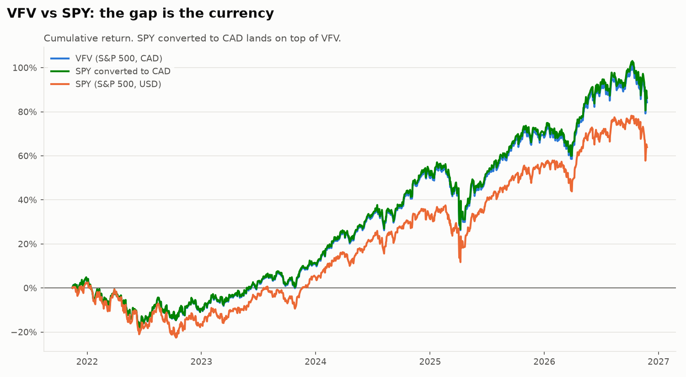
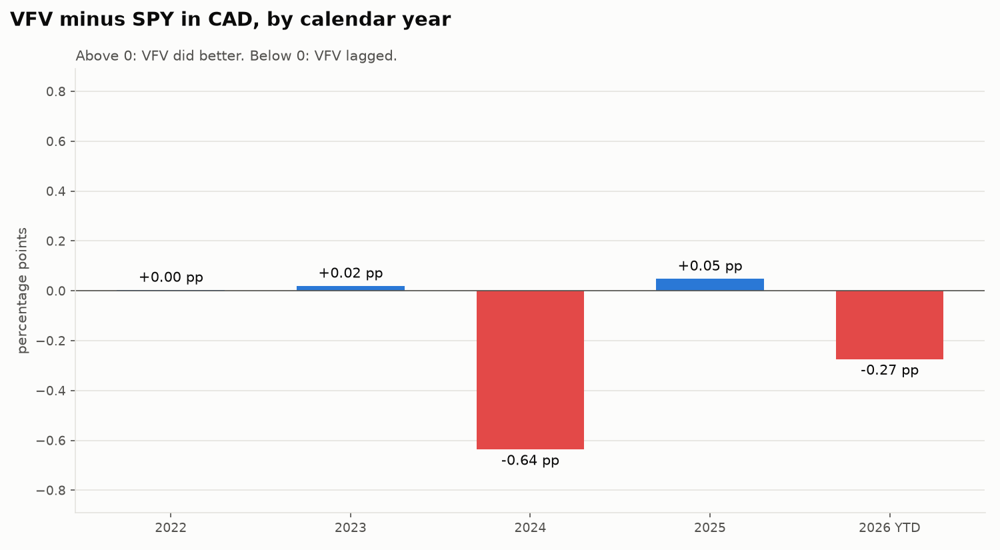

# etf-analytics


A Python tool that downloads 5 years of daily prices for Canadian and US ETFs, cleans and aligns them, analyzes returns, risk and correlation, and generates a full report with one command — with a focus on how a CAD-listed S&P 500 ETF (VFV) compares to SPY.

## Question

VFV and SPY both track the S&P 500. For an investor in Canada, how different is buying VFV in Canadian dollars from holding SPY?

## Key findings

Data: 2021-11-15 to 2026-11-13, 1,227 trading days when both the TSX and NYSE were open.

**1. The gap between VFV and SPY is the currency, not the fund.**
VFV returned 14.3% a year and SPY 11.5% a year. Once SPY is converted to Canadian dollars, it returned 14.4% a year — almost exactly VFV. The difference came from USD/CAD rising from 1.2545 to 1.4261 (+13.7%) over the period.



**2. VFV tracks SPY in CAD closely, with a small expected lag.**
A small lag is expected from VFV's 0.08% fund expense ratio (FER) and the 15% US withholding tax on dividends, because VFV holds the US-listed Vanguard S&P 500 ETF ([Vanguard](https://www.vanguard.ca/en/product/etf/equity/9563/vanguard-sp-500-index-etf), as at Nov 13, 2026).



**3. A weaker Canadian dollar softened losses for Canadian investors.**
The worst drawdown was −22.2% for VFV and −22.6% for SPY in CAD, against −24.5% for SPY in USD: the US dollar strengthened during the 2022 decline. Canadian equity ETFs were less risky still — XIU and XIC had a maximum drawdown of about −16%, volatility of about 13%, and a beta of about 0.6 to SPY.

The full report with all tables and charts is in [`reports/report.md`](reports/report.md).

## Data

Daily prices from Yahoo Finance via `yfinance`. Prices are adjusted for dividends and splits (`auto_adjust=True`). The raw download is cached in `data/raw/prices.csv` so results are reproducible without the network.

| Ticker | What it is | Why it's here |
|---|---|---|
| XIU.TO | TSX 60 (60 large Canadian companies) | Main Canadian benchmark |
| XIC.TO | TSX Composite (whole Canadian market) | Compare with XIU |
| VFV.TO | S&P 500, traded in CAD | Main subject |
| SPY | S&P 500, traded in USD | Benchmark for VFV |
| QQQ | Nasdaq 100 | A different, tech-heavy comparison |
| CAD=X | USD/CAD exchange rate | Convert SPY to CAD |

## Method

### Aligning trading calendars

The TSX and NYSE close on different holidays, so joining the two markets leaves gaps. Over the 5-year period:

| Closed | Days | Examples (2026) |
|---|---|---|
| Canada only | 27 | Victoria Day, Canada Day, Civic Holiday, Thanksgiving (Oct) |
| US only | 27 | MLK Day, Memorial Day, Juneteenth, Independence Day |
| Both | 20 | Family Day / Presidents' Day, Good Friday, Labour Day |

I kept only days when **both markets were open** (1,302 → 1,227 rows). Forward-filling the missing prices would create fake 0% days on holidays and push that day's real move into the next day's return, distorting volatility and correlation.

### Metrics

All metrics are pure functions in `etf_analytics/metrics.py`:

- **Annualized return**: compound growth rate, using calendar years between the first and last date (holidays were dropped, so a year has fewer than 252 rows)
- **Annualized volatility**: standard deviation of daily returns × √252
- **Maximum drawdown**: worst fall from a previous peak
- **Sharpe ratio**: return per unit of volatility, with a **0% risk-free rate**. It is used only to compare the ETFs with each other.
- **Correlation**: how closely the ETFs move together
- **Beta**: sensitivity to SPY

### VFV vs SPY

SPY is converted to Canadian dollars by multiplying its price by the USD/CAD rate, then compared with VFV by calendar year (tracking difference) and day by day (tracking error).

**Limitation:** Yahoo's USD/CAD close is not taken at the 4 p.m. ET market close, so the day-by-day conversion adds timing noise. The daily tracking error (8.6% annualized) is overstated for this reason, and the calendar-year comparison is the more reliable measure.

## How to run

```bash
python3 -m venv .venv
source .venv/bin/activate
python -m pip install -r requirements.txt

python -m etf_analytics.report    # data → metrics → charts → reports/report.md
python -m pytest -v               # run the unit tests
```

The first run reads the cached CSV. Use `python -m etf_analytics.fetch --refresh` to download fresh data. Each step can also be run on its own: `fetch`, `clean`, `tracking`, `charts`.

## Tests

Every metric is checked against small series whose answers can be worked out by hand. For example, prices `[100, 110, 99]` must give returns of `+10%` and `−10%` and a maximum drawdown of `−10%`. The chart and report tests use small fake data with Canadian and US holidays, so the whole suite runs without the network. GitHub Actions runs it on every pull request.

## Project structure

```
etf-analytics/
├── .github/workflows/tests.yml   # run pytest on every PR and push to main
├── data/raw/prices.csv           # cached prices
├── etf_analytics/
│   ├── fetch.py                  # download + cache
│   ├── clean.py                  # align TSX/NYSE trading calendars
│   ├── metrics.py                # return, risk and correlation metrics
│   ├── tracking.py               # VFV vs SPY in CAD
│   ├── charts.py                 # PNG charts
│   └── report.py                 # one-command Markdown report
├── tests/                        # unit and smoke tests
├── reports/                      # report.md + charts
└── requirements.txt
```