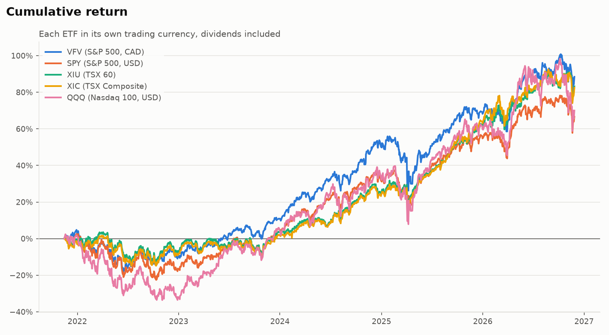
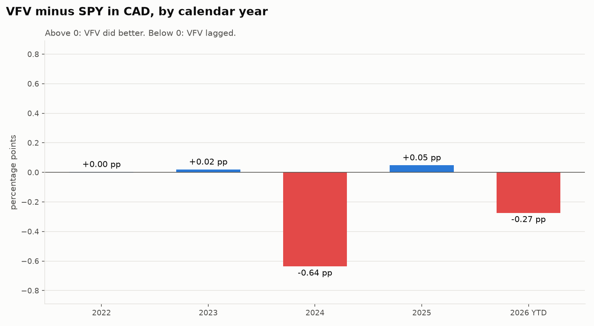

# ETF Analytics Report

**Data:** 2021-11-15 to 2026-11-13, 1,227 trading days when both the TSX and NYSE were open.  
**Generated:** 2026-11-14  
**Sharpe ratio risk-free rate (assumption):** 0.0% per year

## 1. Summary

Each ETF is measured in its own trading currency, with dividends included.

| ETF | Annual return | Volatility | Max drawdown | Sharpe | Beta vs SPY |
|---|---:|---:|---:|---:|---:|
| VFV (S&P 500, CAD) | 14.3% | 15.5% | -22.2% | 0.96 | 0.83 |
| SPY (S&P 500, USD) | 11.5% | 17.4% | -24.5% | 0.73 | 1.00 |
| XIU (TSX 60) | 13.8% | 13.1% | -16.4% | 1.07 | 0.59 |
| XIC (TSX Composite) | 13.6% | 13.5% | -16.2% | 1.04 | 0.61 |
| QQQ (Nasdaq 100, USD) | 12.2% | 23.6% | -35.1% | 0.62 | 1.28 |

## 2. VFV vs SPY

SPY is converted to Canadian dollars with the USD/CAD rate (1.2545 to 1.4261, +13.7% over the period).

|  | Annual return | Volatility | Max drawdown |
|---|---:|---:|---:|
| VFV (S&P 500, CAD) | 14.3% | 15.5% | -22.2% |
| SPY converted to CAD | 14.4% | 18.5% | -22.6% |
| SPY (S&P 500, USD) | 11.5% | 17.4% | -24.5% |

### Calendar-year tracking difference

| Year | VFV | SPY in CAD | Difference (pp) |
|---|---:|---:|---:|
| 2022 | -12.6% | -13.0% | +0.41 |
| 2023 | 23.2% | 23.2% | +0.06 |
| 2024 | 35.2% | 35.5% | -0.23 |
| 2025 | 12.2% | 12.3% | -0.17 |
| 2026 YTD | 15.7% | 16.1% | -0.43 |

Daily tracking error over the full period is 8.58% (annualized). Treat this number with caution: Yahoo's USD/CAD close is not taken at the 4 p.m. ET market close, so converting SPY day by day adds timing noise. The calendar-year comparison above is the more reliable measure.

## 3. Correlation

## 4. Data notes

Only days when both markets were open are used (1,302 rows before alignment, 1,227 after). Closed in Canada only: 27 days. Closed in the US only: 27 days. Closed in both: 20 days.
